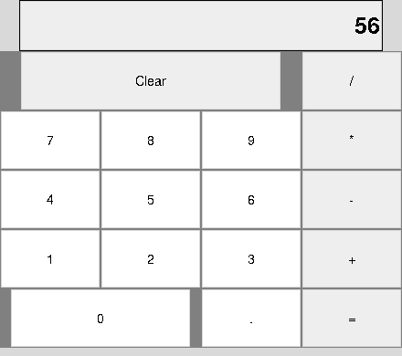

# Week 9 Tkinter Calculator

This Week 9 submission documents a Tkinter calculator. The write-up explains how `StringVar` updates the display, how `grid()` positions the buttons, and how callbacks handle input, clearing, and calculations.

[Read the assignment write-up](Damon_Levy_Week9_Assignment.docx). It also contains the individual GUI proposal for the final project.

This repository contains the write-up and a screenshot of the calculator.

